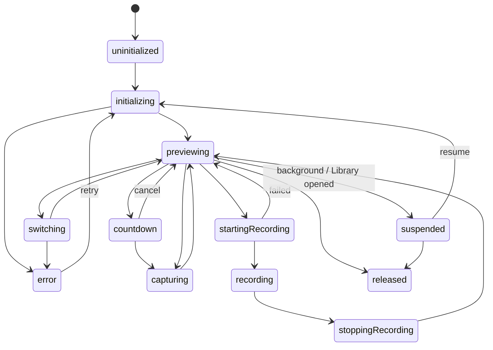
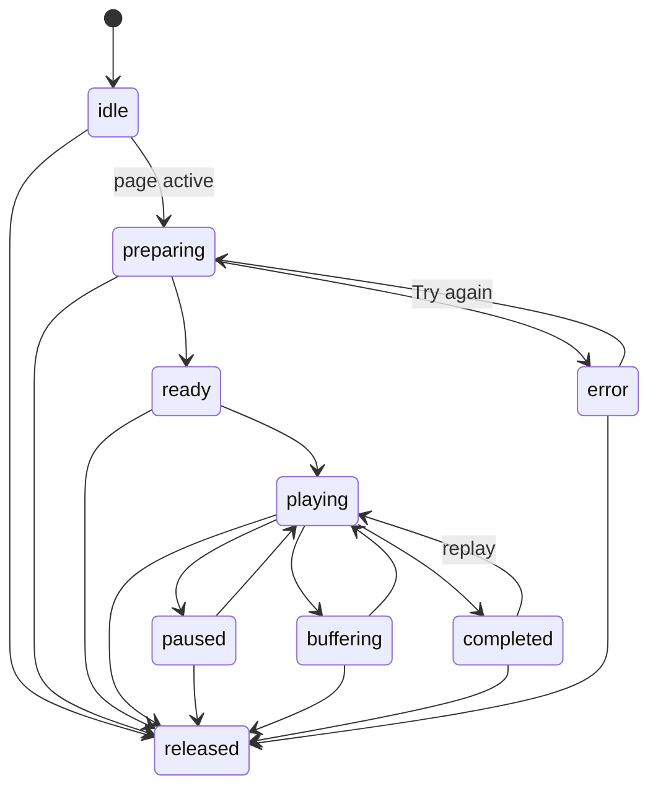
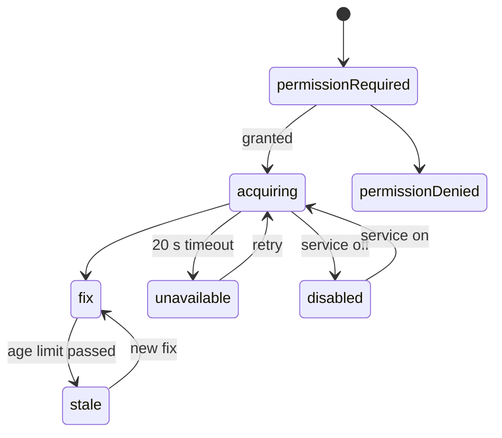
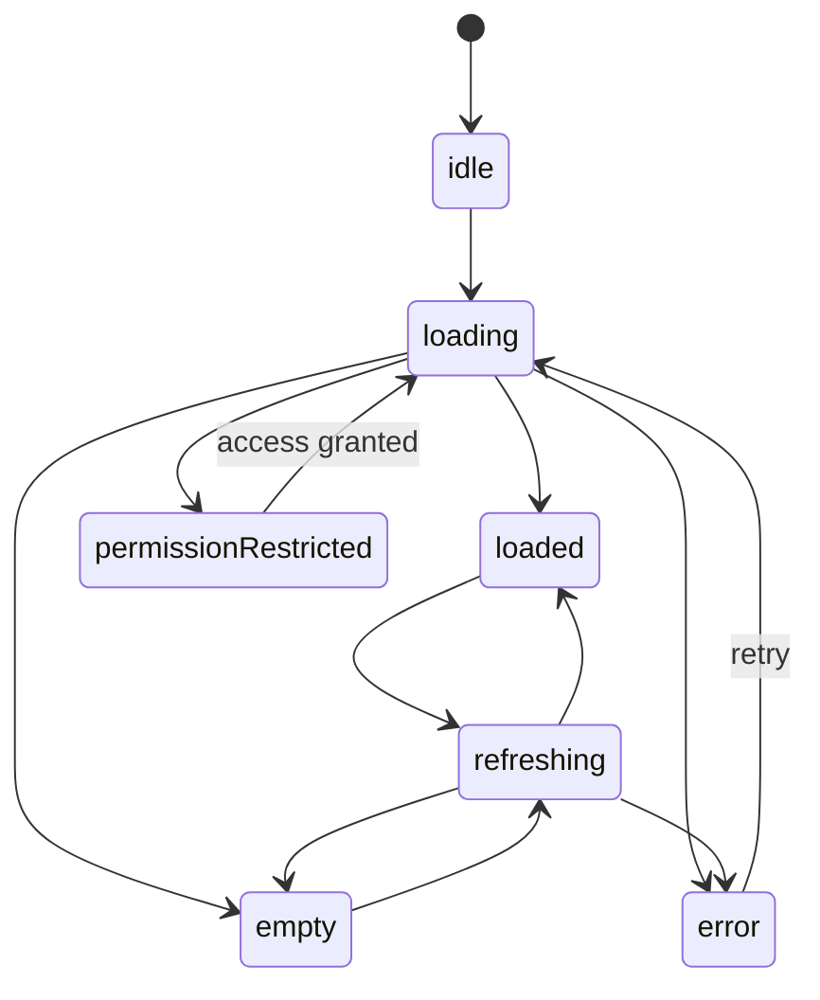

# Production readiness — GPS Camera Next

Audit base: `cee3c36`. Work branch: `claude/gps-camera-next-production-be862f`.
Toolchain: Flutter 3.44.2 / Dart 3.12.2, compile and target SDK 36, min SDK 24.

**Status: CONDITIONALLY READY.** The code builds, every automated check
passes, and the camera, video, Library, viewer and map flows passed on a
Motorola Edge 70. Play submission is still blocked by owner actions: an upload
key, a version code, a privacy policy and the Data safety form (see §H). Grid
pinch still needs one manual check.

## A. Functional audit

| Area | Before | Now | Device-verified |
| --- | --- | --- | --- |
| Photo capture + geostamp | Worked; stills forced to 16:9, green band on Moto Edge 70 | `ResolutionPreset.max` (4096×3072), no band | Yes |
| GPS EXIF on photos | Present | Present; landscape shots store an EXIF orientation tag instead of re-encoding | Yes (one landscape shot) |
| Save original | Worked | Saved to MediaStore, linked to stamped copy for "Compare" | Yes |
| Mic denied | Camera failed to open | Falls back to silent video with a notice | Yes |
| Video recording + stamp export | Plain two-line text stamp; original also saved when "Save original" was on | Same stamp as photos: a picture of the on-screen geostamp, re-taken when the place changes (at most every 10 s), placed where it sits in the viewfinder; sideways recordings are turned upright like sideways photos; the map-style tag is left out of captures; temp files deleted | Yes: 7.4 s stamped video + original saved to `Pictures/GPS Camera Next/` |
| Video playback | **Broken**: handed off by `ACTION_VIEW`, failed with "unsupported" on device | In-app Media3/ExoPlayer via `video_player`: play/pause, scrub, time, mute, aspect, resume position, error + retry, single decoder | Yes: plays with media audio, pause holds the frame, tap-to-seek, mute toggle, replay at end, no audio player left after leaving |
| Library discovery | Private copies + cached paths | MediaStore query of the app album, content URIs, live change observer | Yes (grid lists captures) |
| Library grid | Fixed grid | Newest first; pinch-to-zoom 2/3/4/6 columns (wider on tablets), focal item kept, column count persisted | Grid and saved column count yes; pinch gesture not drivable over adb (single-touch only) |
| Full-screen viewer | Basic page view | Swipe, pinch, double-tap, pan when zoomed, tap toggles chrome, details + location, share, delete with system confirm, back returns to grid position | Yes: double-tap zoom, pan while zoomed stays on the photo, swipe to next, details sheet, Compare button, delete confirm + cancel |
| Media map | None | Newest 20 *geotagged* items, capture location only, dot markers with clustering, preview card → viewer, reset-to-fit, tile-failure banner, empty states | Yes: 13 geotagged items grouped in one marker with count, preview card (thumb, date/time, place, type, duration, "n of 13") swipes and opens the viewer, selection kept after back, pan + reset-to-fit; tile failure not forced |
| Gestures, stamp UI layout | Present | Preserved (right-side zoom, left-side EV/WB, double-tap reset, stamp beside shutter) | Yes (camera screen) |

Removed as dead or replaced: private captures directory, `listVideos`/`openVideo`,
`photoMetadata`, `deleteImage` channels, `video_library.dart`, unused preview
overlay and gallery page, and explanatory hint text on the camera screen.
User-facing features were not removed.

## B. State-machine inventory

Typed machines live in `lib/state/state_machine.dart`. Each transition table is
tested in `test/state_machine_test.dart`.

### Camera (`CameraMachine`)
Replaces the earlier `_initializing`, `_isRecording` and `_switching` booleans.
Open, close and lens flip run through one serialized queue.

A recording can't jump straight to `suspended`. It always stops and finalizes first.

### Video playback (`PlaybackMachine`)

Only the active page owns a player. Before a new one starts, the teardown queue
waits for the previous decoder to be released, with a 3 s bound. Moving the app
to the background pauses playback.

### GPS (`GpsState`)

A stale fix is labelled as stale in the UI and is never written to the stamp or
EXIF as a current location.

### Library (`LibraryStatus`)

Overlapping refreshes merge into one rerun. A generation counter discards results from loads that were superseded.

### Map (`MapPhase`)
`loading → empty | ready → selected`. When the library changes,
`reconcileSelection` keeps the selected item if it still exists and otherwise
clears the selection.

### Others (implicit, documented)
- **Media save:** the shutter snapshot is taken first, so the camera is free again. The save is then queued, and the file stays `IS_PENDING` until it is written, then `IS_PENDING=0`. The index records the capture location. Raw temp files are deleted.
- **Permissions:** camera, then location after the camera opens, then mic only for video, with a silent fallback. Storage access is requested only on API ≤ 28.
- **Navigation:** camera → Library suspends the camera and GPS, and both resume on return. Viewer → back returns the key of the item it was left on, and the grid scrolls to it.
- **Gestures:** two-pointer pinch in the grid uses a continuous column count. On release it settles on the nearest level. In the viewer, paging is locked while zoomed.

## C. Library validation

| Requirement | Evidence |
| --- | --- |
| MediaStore IDs / content URIs, no cached paths | `MediaLibrary.kt` `list`; `MediaItem.uri` |
| Unified photo + video, newest first | `newestFirst`; `media_library_test.dart` |
| Pinch density keeps the focal item | `GridLayout.anchorAt` and `scrollFor`; `media_grid_test.dart` |
| Map limit counts geotagged items only | `latestGeotagged`; test: 30 newer items with no location and 25 older geotagged ones gives the 20 newest geotagged |
| Never uses the device's current location | Locations come only from the capture index or file EXIF |
| Invalid coordinates rejected (null, out of range, 0,0) | `MediaLocation.isValid`; tests |
| All items reachable under clustering | `groupMarkers`; a test checks that every item appears in exactly one group |
| One player, no audio after exit | `media_viewer_test.dart` "holds one player", "stops playback" |
| Position restore | "returns to a video…" test |

## D. Defect register

| # | Severity | Defect | Root cause | Fix | Status |
| --- | --- | --- | --- | --- | --- |
| 1 | Critical | Videos won't play | External `ACTION_VIEW` intent; no handler on device | In-app ExoPlayer page | Fixed, widget-tested; device check pending |
| 2 | High | Green band in saved photos | `ultraHigh` preset gives padded 16:9 JPEG on Moto Edge 70 | `ResolutionPreset.max` | Fixed, device-verified |
| 3 | High | Camera fails when mic denied | `enableAudio: true` unconditionally | Retry without audio + notice | Fixed, device-verified |
| 4 | High | Library missing items / stale paths | Private copies + path cache | MediaStore query + observer | Fixed |
| 5 | Medium | Crash closing an un-zoomed photo | Lazy `late final` animation controller first created in `dispose` | Created in `initState` | Fixed (found by tests) |
| 6 | Medium | Two decoders alive mid-swipe | Dispose not awaited before new init | Static teardown queue | Fixed (found by tests) |
| 7 | Medium | `setState during build` on Library open | Refresh notified synchronously | First notification deferred | Fixed |
| 8 | Medium | Landscape originals lost orientation | EXIF orientation written to every file | Only written to the stamped copy | Fixed |
| 9 | Low | Control-bar thumbnail blank right after capture | Thumbnail not ready yet | One retry after 400 ms | Fixed |
| 10 | Low | `READ_EXTERNAL_STORAGE` requested on all API levels | Manifest merger infers it from the camera plugin | Declared with `maxSdkVersion=28` | Fixed |
| 11 | Low | `READ_MEDIA_IMAGES` requested needlessly | App-owned rows need no permission | Removed | Fixed |
| 13 | Critical | Tapping Share crashed the app | Kotlin `share()` returned `Unit`, which the Flutter channel can't encode (`IllegalArgumentException`, `MediaLibrary.kt:128`) | Reply with `null` | Fixed; found on device; re-tested: share sheet opens, no crash |
| 14 | Low | Map credit "Map data © Esri" barely legible on imagery | Plain text on tiles | Dark pill behind the text | Fixed, device-verified |
| 15 | Low | Viewer header hard to read over bright, zoomed photos | Gradient faded out under the second line | Darker, longer gradient | Fixed |
| 16 | Info | Stamped photo is 1675×2233 vs 4096×3072 original | The stamp is a snapshot of the on-screen preview (existing design) | None; original kept via "Save original" | Open (design decision) |
| 17 | Medium | Video stamp looked unlike the photo stamp | Separate native text overlay | Media3 bitmap overlay of the on-screen stamp | Fixed, device-verified (address, coordinates, time and mini-map in a landscape video) |
| 18 | Medium | Sideways videos played portrait with the stamp sideways | Rotation not baked in | Video turned upright before the stamp | Fixed, device-verified (1920×1080, orientation 0) |
| 19 | Low | "HYBRID" map tag and live dot drawn into captures | On-screen hints in the stamp | Hidden while capturing | Fixed; not seen on device (no GPS fix indoors) |
| 20 | Low | Library pinch jumped and blinked | Hard switch between column counts; thumbnails reloaded mid-gesture | Two neighbouring levels cross-fade about the fingers; thumbnails fixed mid-pinch, swapped gaplessly | Fixed, widget-tested; pinch feel needs a person |
| 21 | Low | Notices, menus and chips used blur, tints and glow | Glass styling | One solid neutral surface | Fixed, device-verified |
| 12 | Blocker | No release signing | No `key.properties` / upload key | **Owner action** | Open |

## E. Test summary

- `flutter analyze`: no issues.
- `flutter test`: **87 passed, 0 failed** (13 files). New files cover the state machines, library loading and limits, grid density and anchoring, map grouping and selection, viewer gestures, and the player lifecycle.
- Device (Motorola Edge 70, Android API 37, debug build `…gps_camera_next.debug`): see the "Device-verified" column in §A.
- **Device session 2 (13 Nov, Wi-Fi ADB):** recording and stamped export passed; Library listed the new video; in-app playback started. A crash on Share was found and fixed (defect 13). Testing paused when the phone was taken back for other use.
- **Device session 3 (13 Nov):** video audio, pause, seek, mute, replay, share (fixed), no playback after exit, and column count across a cold start all passed. Once, the grid showed 4 columns while 6 was saved; this could not be reproduced. The session ended when the phone left the network.
- **Device session 4 (13 Nov, USB):** photo viewer, details, map (markers, preview, selection, reset-to-fit) and the delete confirmation (cancelled, nothing deleted) passed.
- **Blocked / not run on device:** grid pinch (adb can't send multi-touch; needs a person), forced map tile failure, a completed delete, landscape video orientation, tablet layouts, Android ≤ 9. The device was in active personal use (including calls) during the session, so automated input was stopped.

## F. Performance (measured only)

| Metric | Value | Conditions |
| --- | --- | --- |
| Cold start, `am start -W` TotalTime | 893 ms | Previously installed build |
| Cold start, debug launch | 3514 ms / 3079 ms | Debug (JIT) build, first launch; not representative |
| Release AAB size | 63.2 MB (63,217,692 B) | Universal bundle; Play delivers per-ABI splits |
| Release APK size | 65.9 MB | Fat APK (all ABIs) |

No frame-timing or memory profile of the release build was captured. No
smoothness claims are made.

## G. Production build

- `build/app/outputs/bundle/release/app-release.aab`
  SHA-256 `d406bc14b225d96acb5d7929b2a4f222bf79a18aa66d3bb01d04404bfae3e0f0`
- `build/app/outputs/flutter-apk/app-release.apk`
  SHA-256 `5bc450a3184c963127da306bb9f6cb4cfba9ab2d11a609ab19b288f8df862d3e`
- Package `com.gpscamera.gps_camera_next`, version `0.1.0` (code 1).
- **Signed with the debug key** because `android/key.properties` is absent.
  R8/resource shrinking is enabled only when the key file is present. Play
  will reject this bundle as built. Build artifacts are not committed.

## H. Google Play checklist

| Item | State |
| --- | --- |
| Target SDK 36 (meets current Play requirement) | Done |
| Least-privilege permissions: camera, fine/coarse location (foreground only), mic, internet; storage only ≤ API 28; no background location | Done |
| Upload keystore + `key.properties` (never committed) | **Owner action** |
| Version code above any previously uploaded build | **Owner action**: currently `0.1.0+1` |
| Release build with R8 on, smoke-tested on device | Pending signing |
| Device pass on the blocked items in §E | **Pending** |
| Privacy policy URL | **Owner action** |
| Data safety form: precise location (stored in photos/videos the user saves, not collected by the developer); coordinates sent to the platform geocoder and OpenStreetMap Nominatim for address lookup; map tiles from Esri | **Owner action**, facts listed here |
| Store listing, screenshots, content rating | **Owner action** |
| Submission / approval | Not done, not claimed |
